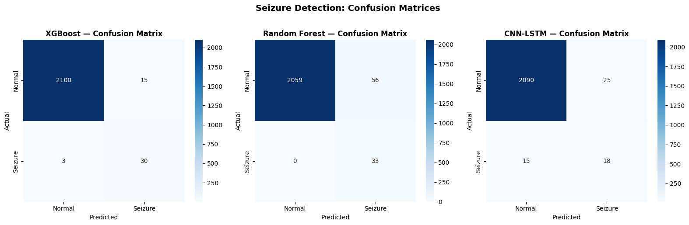
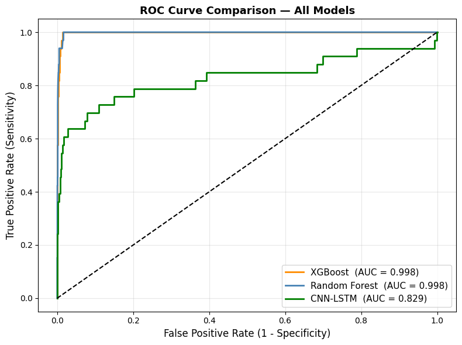
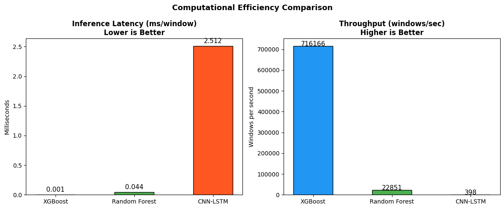
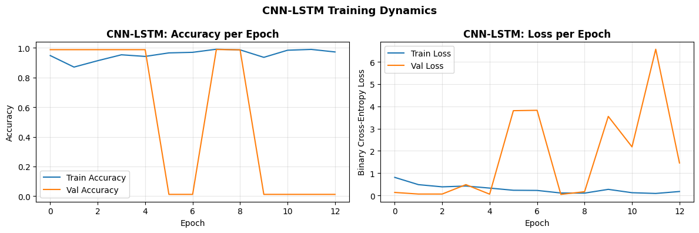
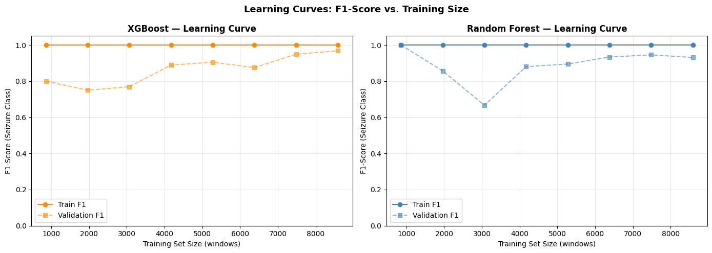
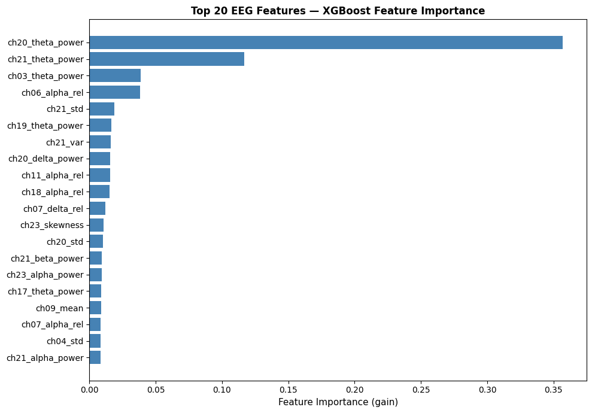
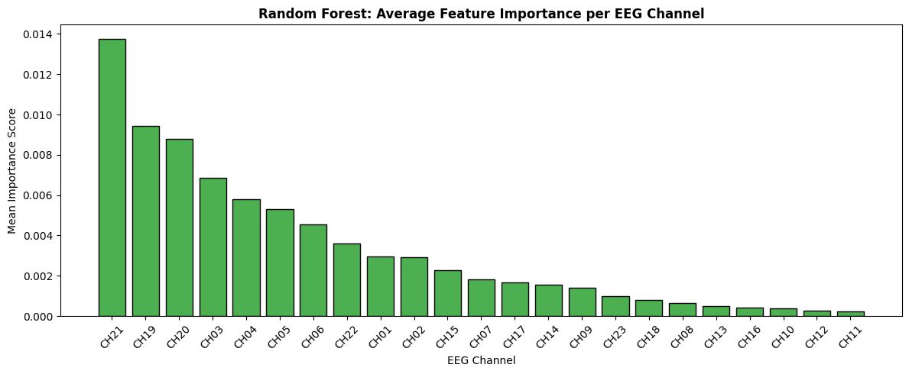

# Epileptic Seizure Detection from EEG (CHB-MIT)

MSc AI project (National College of Ireland). Compares XGBoost, Random Forest and a CNN-LSTM for detecting seizures in scalp EEG. Research prototype, not for clinical use.

## Method
- Data: CHB-MIT Scalp EEG, subjects chb01 to chb06 (26 recordings that contain annotated seizures), 23 channels, 256 Hz.
- Preprocessing: 0.5-40 Hz band-pass filter, 5-second non-overlapping windows. A window is labelled seizure if its start falls inside an annotated seizure.
- Features (XGBoost, Random Forest): 299 per window, made of mean, std, variance, skewness, kurtosis, and delta/theta/alpha/beta band power (absolute and relative) for each channel.
- CNN-LSTM: trained on the raw windows (1280 x 23).
- Split: chronological 80/20. Class imbalance handled with class weights; decision thresholds for Random Forest and CNN-LSTM tuned on a validation slice.

## Results (test set: 2,148 windows, 33 of them seizure)

| Model | Accuracy | F1 (seizure) | Sensitivity | False alarm rate | AUC-ROC | Latency (ms/window) |
|---|---|---|---|---|---|---|
| XGBoost | 99.16% | 0.769 | 90.9% (30/33) | 0.71% (15 false alarms) | 0.998 | 0.001 |
| Random Forest | 97.39% | 0.541 | 100% (33/33) | 2.65% (56 false alarms) | 0.998 | 0.044 |
| CNN-LSTM | 98.14% | 0.474 | 54.5% (18/33) | 1.18% (25 false alarms) | 0.829 | 2.512 |

XGBoost gave the best balance. Random Forest caught every seizure but raised the most false alarms. The CNN-LSTM was the weakest and slowest.

## Figures

## Limitations
- Only 6 patients, and the test set has just 33 seizure windows, so the numbers are noisy.
- Not patient-independent: windows from the same patients appear in both training and test data, so results will not transfer to new patients.
- Only recordings that contain seizures were used, so class imbalance is milder than in full recordings.
- The CNN-LSTM trained unstably (validation accuracy jumps between about 0.99 and 0.01, see fig4).
- Random Forest's threshold was tuned on the last 10% of its own training data, which is not an independent validation set.
- Learning curves use a random inner split, so they are optimistic.
- Latency is batch prediction time divided by the number of windows, not single-window latency.

## Data
Not included. Download the CHB-MIT Scalp EEG Database from PhysioNet:
https://physionet.org/content/chbmit/1.0.0/

Arrange the files like this (only the files listed in the notebook's `seizure_map` are used):

Data/
  chb01/chb01_03.edf ...
  chb02/ ...
  ...
  chb06/

## Run it
1. Install the requirements: `pip install -r requirements.txt`
2. Put the data in `Data/` as shown above.
3. Run `seizure_detection_code.ipynb` from top to bottom.

## Citation
- Shoeb, A. H. (2009). Application of Machine Learning to Epileptic Seizure Onset Detection and Treatment. PhD thesis, MIT.
- Goldberger, A. L. et al. (2000). PhysioBank, PhysioToolkit, and PhysioNet. Circulation, 101(23).
